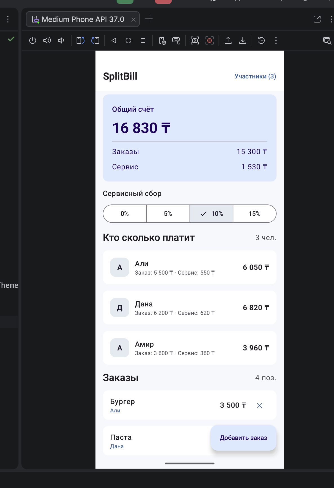
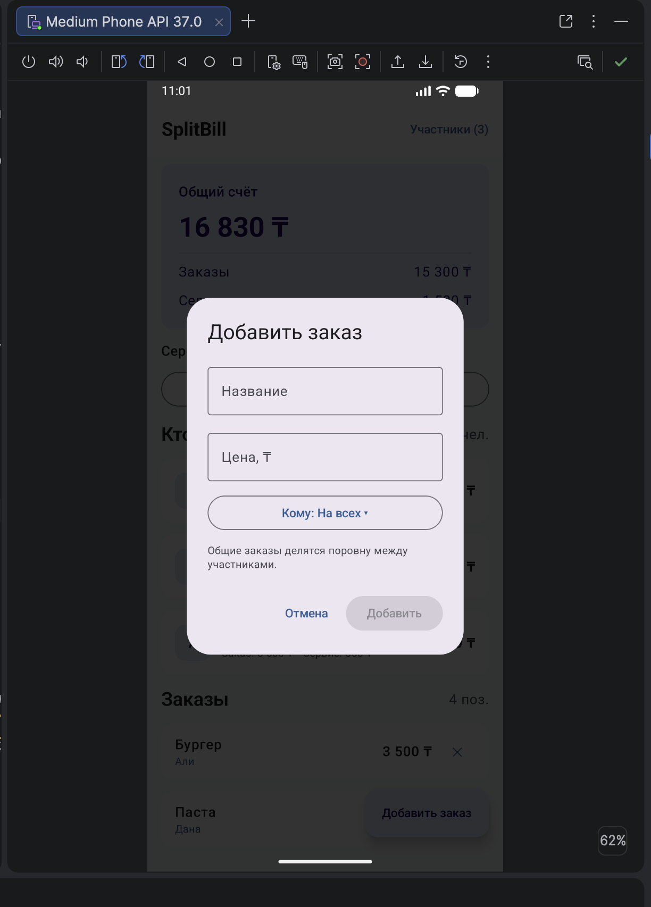

# SplitBill

A simple Android application for splitting restaurant bills among friends. Built with Kotlin, Jetpack Compose, and Material 3.

## Features

- Add and remove participants.
- Add food items and assign them to a specific person or split them equally among everyone.
- Remove food items.
- Select a service charge: 0%, 5%, 10%, or 15%.
- Automatically calculate each participant's share and the total bill.
- All amounts are stored as whole Kazakhstani tenge (KZT) to avoid losing money when splitting shared items and rounding service charges.
- Demonstrates state preservation during screen rotation.

## How to Run

1. Install **Android Studio**, Android SDK Platform 35, and JDK 17.
2. Open the `SplitBill` folder using **File → Open**.
3. Wait for Gradle Sync to complete (an internet connection is required to download dependencies for the first time).
4. Select an Android Emulator running API 26+ or connect a physical Android device.
5. Click **Run app**.

If Android Studio reports that the Gradle Wrapper JAR is missing, select a locally installed Gradle 8.11.1 or run `gradle wrapper --gradle-version 8.11.1` from the project root (if Gradle is installed).

## Technologies

Kotlin, Jetpack Compose, Material 3, ViewModel, Gradle Kotlin DSL.

## Project Structure

- `model/Bill.kt` — data models and calculation logic.
- `viewmodel/BillViewModel.kt` — manages participants, orders, and service charges.
- `ui/SplitBillScreen.kt` — user interface and reusable Composable components.
- `ui/Theme.kt` — application theme and styling.
- `BillCalculatorTest.kt` — two unit tests for rounding and splitting calculations.

## State Management

- **remember** — used for temporary UI state, such as the `expanded` flag of a dropdown menu. This state does not survive Activity recreation.
- **rememberSaveable** — used for text field values and dialog visibility flags. These values are restored during Activity recreation, including screen rotation.
- **ViewModel** — manages participants, orders, and the service charge percentage. It survives configuration changes such as screen rotation, but does not automatically preserve data after the application process is terminated. A persistent database is intentionally not included.

### How to Test Screen Rotation

1. Add a new participant and an order.
2. Change the service charge to 15%.
3. Rotate the emulator to landscape mode and back to portrait mode.
4. Verify that the participants, orders, total amount, and service charge remain unchanged.
5. Additionally, open the Add Order dialog, enter part of an item name, and rotate the screen. The entered text should remain in the field.

## Screenshots

Screenshots of the application running in the Android Emulator:

- `screenshots/main.png` — main screen showing the bill calculation.
- `screenshots/add-order.png` — Add Order dialog.

## Notes

The application runs locally without a backend server. Data is not persisted between full application restarts.

When a participant is removed, their individual orders are also removed. Shared items remain and are redistributed among the remaining participants.