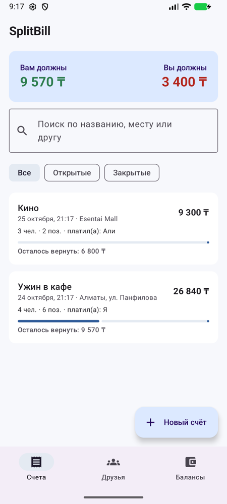
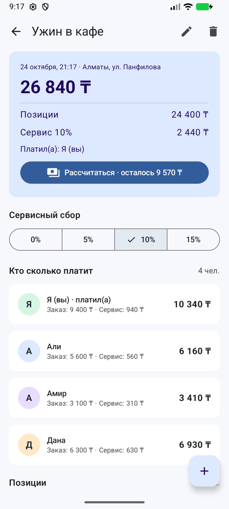
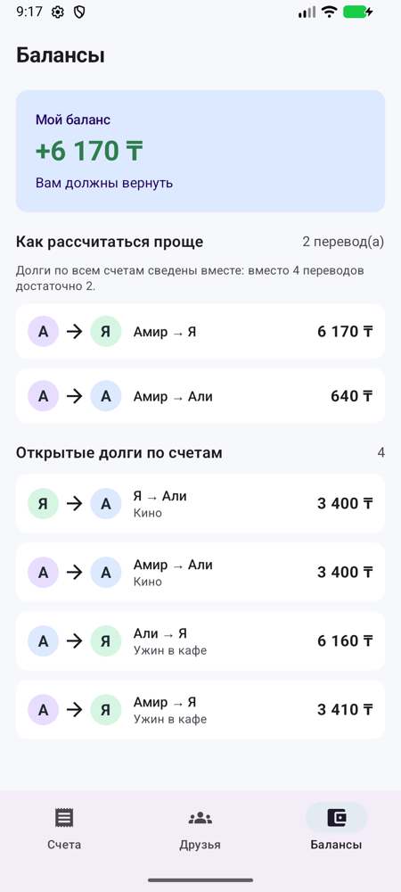
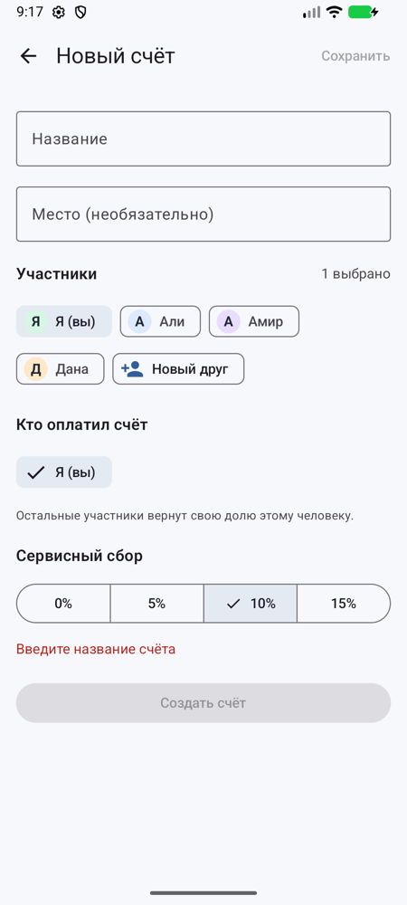
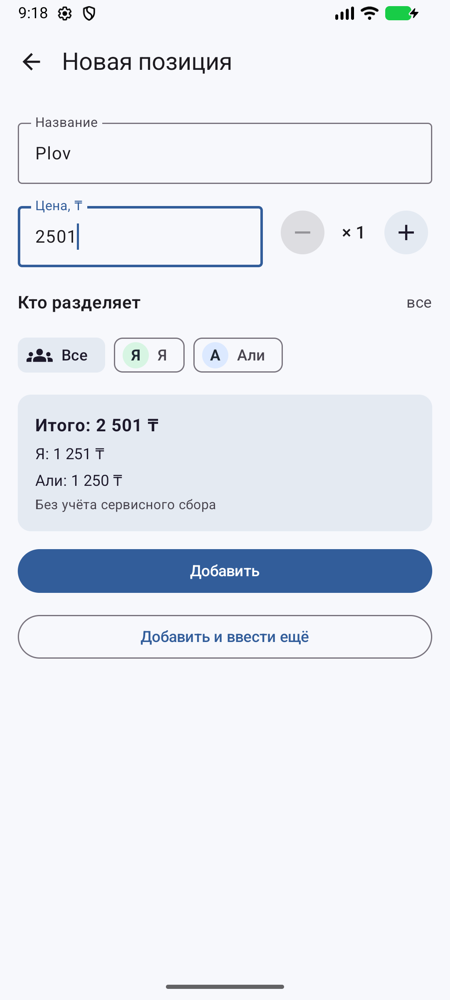

# SplitBill — Midterm

This project extends the HW_2 SplitBill app. HW_2 split a single restaurant bill on one screen, and its data was lost when the app closed. The midterm version keeps a **history of bills with friends**. For each bill it tracks **who paid**, **who still owes money**, and how the group can **settle all debts with the fewest transfers**.

Built with Kotlin, Jetpack Compose, Material 3, Navigation Compose, ViewModel + StateFlow, and Room.

## Features

- **Bills list**: all bills with search (by title, place or friend) and filters (all / open / settled). A summary card shows how much you are owed and how much you owe.
- **Create / edit bill**: title, place, participants (friends can be added inline), who paid, and the service charge.
- **Bill detail**: total, service, each person's share, and the item list. Tap an item to edit it. Deleting an item shows a snackbar with **Undo**.
- **Item editor**: price, quantity, and split between **everyone or any subset of people** (HW_2 only supported one person or everyone). A live preview shows what each person pays. "Add and enter another" lets you type in a whole receipt quickly.
- **Settle up**: who owes the payer and how much. Mark repayments with checkboxes, track progress, and **share the breakdown** to WhatsApp or Telegram through the Android share sheet.
- **Friends**: add, rename, delete (blocked if the friend is in a bill), with each friend's spending and net balance.
- **Balances**: debts across all bills netted together, plus a **simplified transfer plan** (for example, 4 debts become 2 transfers).
- Data is stored in a **Room database** and survives app restarts. A fresh install contains demo data.
- Money is stored as whole tenge (`Long`), and rounding never loses or creates a tenge.

## How to Run

1. Open the `Midterm` folder in Android Studio (**File → Open**).
2. Gradle JDK: 17 or 21 (**Settings → Build Tools → Gradle → Gradle JDK**).
3. Wait for Gradle Sync, choose an emulator (API 26+), and click **Run**.

From the command line: `./gradlew assembleDebug` builds the app and `./gradlew testDebugUnitTest` runs the unit tests.

## Requirements Checklist

| Requirement | Where |
|---|---|
| ≥ 3 screens with Navigation Compose | 7 screens, `ui/navigation/SplitBillNavHost.kt`, `Routes.kt` |
| ≥ 3 meaningful features | bill splitting (subsets, quantity, service), settle-up tracking + sharing, cross-bill balances with debt simplification, search/filter, friends |
| Material 3, reusable components, consistent styling | `ui/theme/Theme.kt` (light/dark), `ui/components/Common.kt` (`Avatar`, `SectionHeading`, `MoneyRow`, `EmptyState`, `BackButton`), `NewFriendDialog` reused on 2 screens |
| User input, events, interactive state | text fields, chips, segmented buttons, checkboxes, quantity stepper, dialogs, snackbar with Undo |
| `remember` | `SnackbarHostState` (`BillDetailScreen`, `FriendsScreen`), `remember(amount, sharers)` split preview (`ItemEditorScreen`) |
| `rememberSaveable` | dialog flags (`confirmDelete`, `addFriend`, `adding`, `renamingId`), typed name in `NewFriendDialog` |
| State hoisting | `BillsScreen` (stateful) → `BillsContent` (stateless, has `@Preview`); `BillCard`, `ItemCard`, `DebtRow`, `ShareCard` take data + callbacks |
| ViewModel + StateFlow + lifecycle-aware collection | 6 ViewModels, `stateIn(WhileSubscribed(5000))`, `collectAsStateWithLifecycle()` in every screen |
| Separation of UI / logic / state | `model/` (pure logic), `data/` (storage), `ui/*/ViewModel` (state), `ui/*/Screen` (UI) |
| Kotlin classes, collections, functions, coroutines | data/sealed classes, enums, `groupBy`/`associate`/`flatMap`, extension functions, `viewModelScope.launch`, `Flow.combine` |
| Configuration changes | forms, query and filter live in ViewModels; dialogs in `rememberSaveable`; data in Room |

### How to Check Rotation

1. Open **New bill**, type a title, select friends, then rotate the screen: the form is unchanged (ViewModel).
2. Open **Friends → Add**, type a name, then rotate: the dialog and the typed text remain (`rememberSaveable`).
3. On **Bills**, type a search query and pick a filter, then rotate: the list stays filtered.

## Architecture (MVVM + Repository)

```
UI (Compose screens)  ──events──▶  ViewModel  ──suspend calls──▶  Repository  ──▶  Room DAO  ──▶  SQLite
        ▲                              │                              │
        └────── StateFlow<UiState> ◀───┴──── Flow<List<Bill>> ◀───────┘
```

| Layer | Package | Responsibility |
|---|---|---|
| Model (domain) | `model/` | Pure Kotlin: `Bill`, `Friend`, `BillItem`, `Debt`. `BillCalculator` splits money and `Balances` nets and simplifies debts. No Android dependencies, so it is unit-tested. |
| Data | `data/` | Room entities (6 tables), `SplitBillDao`, `AppDatabase` (with seed data), and `SplitBillRepository`, which combines the tables into domain `Bill` objects. |
| ViewModel | `ui/*/…ViewModel.kt` | Holds screen state as `StateFlow`, turns repository flows into UI state with `map`/`combine` + `stateIn`, and runs writes in `viewModelScope`. |
| UI | `ui/*/…Screen.kt` | Stateless where possible: reads state with `collectAsStateWithLifecycle()` and sends events to the ViewModel. |
| DI | `SplitBillApp.kt`, `ui/AppViewModelProvider.kt` | Manual dependency injection: `AppContainer` creates the database and repository once, and a `viewModelFactory` builds each ViewModel. |

**Unidirectional data flow:** the UI never changes data directly. For example, tapping a checkbox calls `viewModel.setRepaid()`, which writes to Room. Room re-emits its `Flow`, the repository rebuilds `Bill`, the ViewModel emits new state, and Compose recomposes. Every screen updates automatically, including the Bills list and Balances.

## Navigation

Type-safe Navigation Compose (`ui/navigation/`). Each destination is a `@Serializable` class, and its fields are the arguments:

- Bottom-bar tabs: `BillsRoute`, `FriendsRoute`, `BalancesRoute`. They use `popUpTo(start) { saveState = true }`, `launchSingleTop` and `restoreState`, so each tab keeps its scroll position and is never duplicated.
- `BillDetailRoute(billId)`, `BillEditorRoute(billId = 0 → new)`, `ItemEditorRoute(billId, itemId = 0 → new)`, `SettleRoute(billId)`.
- ViewModels read arguments from `SavedStateHandle` (`savedStateHandle.toRoute<ItemEditorRoute>()`).
- After a new bill is created, the editor is replaced by the bill detail (`popUpTo<BillEditorRoute> { inclusive = true }`), so Back returns to the list rather than the empty form.
- The bottom bar is shown only on the top-level destinations (checked with `destination.hierarchy.any { it.hasRoute(...) }`).

## State Management

| Where | What | Survives rotation | Survives app restart |
|---|---|---|---|
| `remember` | `SnackbarHostState` | ✗ | ✗ |
| `rememberSaveable` | dialog visibility, the name typed in the friend dialog | ✓ | ✗ |
| ViewModel `StateFlow` | form contents (bill / item editor), search query, filter | ✓ | ✗ |
| Room | friends, bills, items, repayments | ✓ | ✓ |

Text field values in the editors are kept in a `MutableStateFlow` that is updated synchronously, rather than a flow that goes through the database, so typing is never delayed.

## Money Calculation

- An item split among *n* people: each pays `amount / n`, and the first `amount % n` people pay 1 ₸ more.
- Service = `round(subtotal × percent)`. It is distributed in proportion to each person's order using the **largest remainder method**, so leftover tenge go to whoever has the largest fractional part, never to someone who ordered nothing.
- Debts: every participant except the payer owes the payer their full share.
- Balances: unpaid debts are netted per person. A greedy algorithm (largest debtor pays largest creditor) produces at most *n − 1* transfers.

Tests: `app/src/test/.../BillCalculatorTest.kt` and `BalancesTest.kt` (8 tests).

## Screenshots

| Bills | Bill detail | Balances |
|---|---|---|
|  |  |  |

| New bill | New item |
|---|---|
|  |  |
